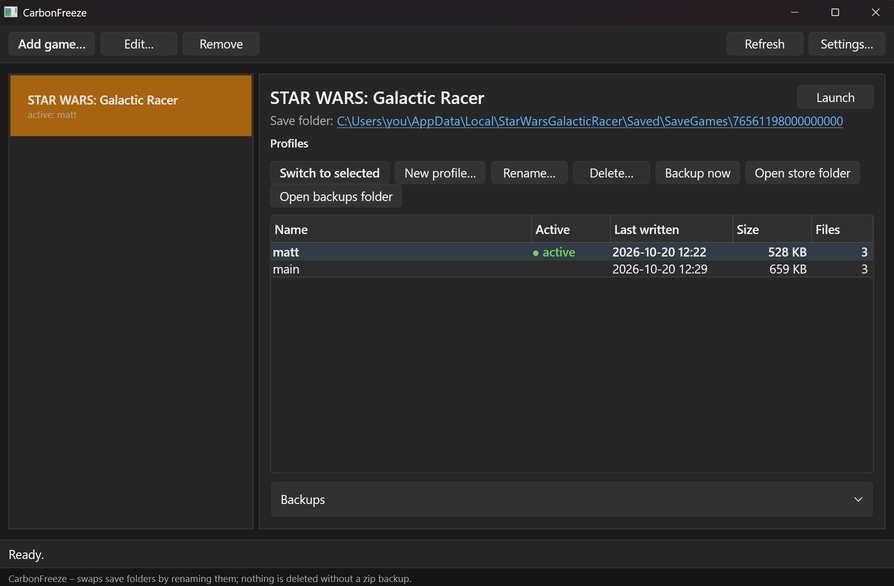
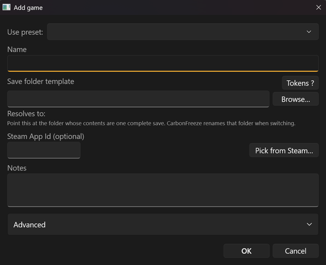

# CarbonFreeze

Freeze a save. Thaw it later.

A small Windows tool for games that only keep one save. CarbonFreeze lets you keep several
independent saves ("profiles") for the same game and swap between them in one click, so two
people can share a PC, or you can keep a "before the boss" snapshot without touching the game.





## Download

- **[Latest release](https://github.com/mfleshner/CarbonFreeze/releases/latest)**: a single
  `CarbonFreeze.exe`, nothing to install, no runtime needed. Put it anywhere and run it.
- Windows Package Manager, once the manifest is accepted: `winget install mfleshner.CarbonFreeze`

The exe is not code-signed yet, so Windows SmartScreen shows "Windows protected your PC" on
first run. Click **More info**, then **Run anyway**. The source is here if you would rather
build it yourself (see *Build and publish*).

Works with any game that keeps its save in a folder. Steam games are picked from a list and
the save folder is filled in automatically for most of them.

## How it works (and why it is safe)

A game's save is a folder. CarbonFreeze never edits files inside it; it only moves whole folders:

1. **Backup first.** The current save folder is zipped into the game's backups folder.
2. **Park.** The save folder is renamed into the store under the active profile's name
   (`<store>\<game>\profiles\<name>`).
3. **Swap in.** The target profile's folder is renamed back into the save location. If the
   target does not exist yet, an empty folder is created so the game starts fresh.
4. The config records which profile is now active.

On the same drive these are plain directory renames, which are atomic and instant. Across
drives it falls back to copy, verify, delete. Deleting a profile zips it first, and removing a
game from the list only forgets it; no files are touched. In short:
**nothing is deleted without a zip backup.**

Old backups are pruned per game once there are more than *Max backups per game* (Settings;
0 keeps everything).

## Steam Cloud warning

If Steam Cloud is enabled for a game, Steam will happily "restore" whatever it last synced on
top of the profile you just swapped in. CarbonFreeze shows a yellow banner when it detects cloud
data for the game (`userdata\<id>\<appid>\remotecache.vdf` exists) and the game's Cloud switch
has not been turned off (`cloudenabled "0"` in `userdata\<id>\7\remote\sharedconfig.vdf`).
Before switching, turn it off in
**Steam > Library > right-click the game > Properties > General > Steam Cloud**.

## Build and publish

Requirements: .NET 10 SDK, Windows.

```
dotnet build src\CarbonFreeze.App          # debug build
dotnet test                              # core library tests
.\publish.ps1                            # single-file, self-contained publish\CarbonFreeze.exe
```

`publish.ps1` runs
`dotnet publish src\CarbonFreeze.App -c Release -r win-x64 --self-contained -p:PublishSingleFile=true -o publish`.
The single-file / self-contained settings are only active in the Release configuration so a
plain `dotnet build` stays fast.

Solution layout:

- `src\CarbonFreeze.Core` - path expansion, Steam discovery, profile swap, config, presets. No UI.
- `src\CarbonFreeze.App` - WPF front end (MVVM, CommunityToolkit.Mvvm).
- `tests` - core unit tests.

## Adding a game

1. **Add game...** in the toolbar.
2. Either pick a **preset** from the drop-down (fills everything in), or:
   - **Pick from Steam...** to choose an installed Steam game (fills the name, app id and save folder: from a preset when one matches, otherwise derived from Steam's own cloud-sync records in `userdata\<id>\<appid>\remotecache.vdf`, otherwise by looking for a folder named after the game under the usual save locations; and the
     template too when the game matches a preset), or
   - type a **Name** and a **Save folder template**, using **Browse...** to point at the folder
     whose *contents* are one complete save.
3. Watch the **Resolves to:** line; it shows the expanded path and whether it exists right now.
4. OK. The game appears on the left with `main` as its active profile.

Then on the right: **New profile...** parks the current save under the active name and starts
an empty one; **Switch to selected** (or Enter / double-click) swaps profiles; **Rename...**,
**Delete...** (zips first) and **Backup now** do what they say. The **Backups** expander lists
every zip with an *Open folder* button. The **Launch** button starts the game through Steam
when an app id is set.

Editing a game's template after profiles exist is allowed; the parked profiles stay where
they are in the store and are swapped into the new location on the next switch.

## Template tokens

The save folder template is expanded at use time. Windows environment variables
(`%LOCALAPPDATA%`, `%APPDATA%`, `%USERPROFILE%`, ...) work, plus these tokens:

| Token           | Meaning                                                        |
|-----------------|----------------------------------------------------------------|
| `{SteamId64}`   | 17-digit Steam id of the most recently logged-in Steam user     |
| `{SteamId3}`    | Short numeric Steam id (the folder name under `Steam\userdata`) |
| `{UserProfile}` | `C:\Users\<you>`                                                |
| `{Documents}`   | Your Documents folder (follows OneDrive redirection)            |
| `{SavedGames}`  | `C:\Users\<you>\Saved Games`                                    |
| `{LocalLow}`    | `%USERPROFILE%\AppData\LocalLow`                                |

Example: `%APPDATA%\EldenRing\{SteamId64}`. The **Tokens ?** button in the Add/Edit dialog
shows the live list from the path expander. A Steam token with no Steam user found is reported
as an error in the dialog and in the game header.

## Where things live

| What                       | Default location                                   |
|----------------------------|----------------------------------------------------|
| Config (`config.json`)     | `%APPDATA%\CarbonFreeze\config.json`                 |
| Store (parked profiles)    | `%LOCALAPPDATA%\CarbonFreeze\Store\<game>\...`       |
| Backups (zips)             | inside the game's store folder                     |

The store root can be changed globally in **Settings...** or per game under **Advanced >
Store root override** in the game dialog. Changing it does not move existing profiles.
**Settings...** also shows the config path with an **Open** button, and has a **Theme** choice:
System (follows the Windows app mode, the default), Light or Dark. The change applies immediately.

Keyboard: **Enter** on a profile row switches, **Delete** deletes (with confirmation), **F5**
refreshes.

## Support

CarbonFreeze is free and open source. If it saved your save, you can
[buy me a coffee on Ko-fi](https://ko-fi.com/mfleshner).

## Upgrading from SaveSwitch

CarbonFreeze used to be called SaveSwitch. The first run moves the old config
(`%APPDATA%\SaveSwitch\config.json`) and the old store (`%LOCALAPPDATA%\SaveSwitch\Store`) to
the new names. Close any running SaveSwitch.exe first and delete it afterwards; nothing else
changes.

## License

MIT. See [LICENSE](LICENSE).
